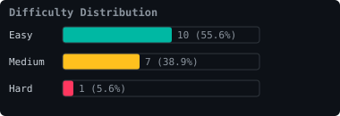
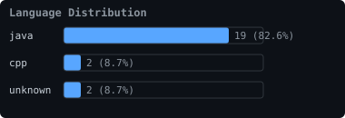
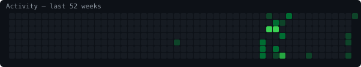

# 🧠 LeetCode Journey

*Automated progress tracker powered by [CodeStreak](https://github.com/AdarshShinde0608/CodeStreak)*

---

| 🔥 Current Streak | 🏆 Longest Streak | ✅ Total Solved | 📅 This Year |
|:-----------------:|:-----------------:|:--------------:|:------------:|
| **1 days** | **4 days** | **21** | **21** |

> **Today's Status:** ✅ GOAL MET

---

## 📊 Difficulty Breakdown

| Difficulty | Count | Percentage |
|:----------:|:-----:|:----------:|
| 🟢 Easy    | 10 | 50.0% |
| 🟡 Medium  | 9 | 45.0% |
| 🔴 Hard    | 1 | 5.0% |

---

## 🌐 Languages

| Language | Problems | % |
|:--------:|:--------:|:-:|
| Java | 19 | 82.6% |
| C++ | 2 | 8.7% |
| unknown | 2 | 8.7% |

---

## 🧩 Platforms

| Platform | Problems |
|:--------:|:--------:|
| leetcode | 20 |
| geeksforgeeks | 1 |

---

## 🗂️ Top Topics

| Topic | Problems |
|:-----:|:--------:|
| Two Pointers | 11 |
| Linked List | 9 |
| Array | 7 |
| Hash Table | 6 |
| Floyd's Cycle Finding Algorithm | 4 |
| Binary Search | 4 |
| Sorting | 3 |
| Math | 3 |
| Recursion | 3 |
| Sliding Window | 3 |

---

## 🔥 Streak Details

| Metric | Value |
|:------:|:-----:|
| Current Streak | **1 days** |
| Longest Streak | **4 days** |
| Total Active Days | **22** |
| Streak Since | 2026-11-09 |
| Last Solved | 2026-11-09 |

---

## 🕐 Recent Submissions

| # | Platform | Problem | Difficulty | Language | Date |
|:-:|:--------:|:-------:|:----------:|:--------:|:----:|
| 234 | leetcode | [Palindrome Linked List](https://leetcode.com/problems/palindrome-linked-list/) | 🟢 Easy | unknown | 2026-11-09 |
| 19 | leetcode | [Remove Nth Node From End of List](https://leetcode.com/problems/remove-nth-node-from-end-of-list/) | 🟡 Medium | Java | 2026-11-07 |
| 2747 | leetcode | [Count Zero Request Servers](https://leetcode.com/problems/count-zero-request-servers/) | 🟡 Medium | Java | 2026-11-06 |
| 1385 | leetcode | [Find the Distance Value Between Two Arrays](https://leetcode.com/problems/find-the-distance-value-between-two-arrays/) | 🟢 Easy | Java | 2026-11-05 |
| 7 | leetcode | [Reverse Integer](https://leetcode.com/problems/reverse-integer/) | 🟡 Medium | Java | 2026-11-04 |
| 3 | leetcode | [Longest Substring Without Repeating Characters](https://leetcode.com/problems/longest-substring-without-repeating-characters/) | 🟡 Medium | Java | 2026-11-02 |
| 28 | leetcode | [Find the Index of the First Occurrence in a String](https://leetcode.com/problems/find-the-index-of-the-first-occurrence-in-a-string/) | 🟢 Easy | Java | 2026-11-01 |
| max-sum-subarray-of-size-k5313 | geeksforgeeks | [Maximum Sum Subarray of Size K](https://practice.geeksforgeeks.org/problems/max-sum-subarray-of-size-k5313/) | 🔴 Hard | C++ | 2026-09-23 |
| 209 | leetcode | [Minimum Size Subarray Sum](https://leetcode.com/problems/minimum-size-subarray-sum/) | 🟡 Medium | unknown | 2026-08-27 |
| 209 | leetcode | [Minimum Size Subarray Sum](https://leetcode.com/problems/minimum-size-subarray-sum/) | 🟡 Medium | unknown | 2026-08-27 |

---

## 🏆 Achievements

| Achievement | Status | Date |
|:-----------:|:------:|:----:|
| 🎯 First Problem | ✅ Unlocked | 2026-11-09 |
| 🏆 10 Problems | ✅ Unlocked | 2026-11-09 |
| 🏆 25 Problems | 🔒 Locked | — |
| 🏆 50 Problems | 🔒 Locked | — |
| 🏆 100 Problems | 🔒 Locked | — |
| 🏆 250 Problems | 🔒 Locked | — |
| 🏆 500 Problems | 🔒 Locked | — |
| 🏆 1000 Problems | 🔒 Locked | — |
| 🔥 Week Warrior | 🔒 Locked | — |
| 🔥 Month Master | 🔒 Locked | — |
| 🔥 Century Coder | 🔒 Locked | — |
| 🔥 Year of Code | 🔒 Locked | — |

---

*Auto-generated by [CodeStreak](https://github.com/AdarshShinde0608/CodeStreak) · Last updated: Mon, 09 Nov 2026 15:31:47 GMT*

